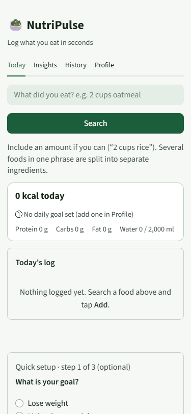
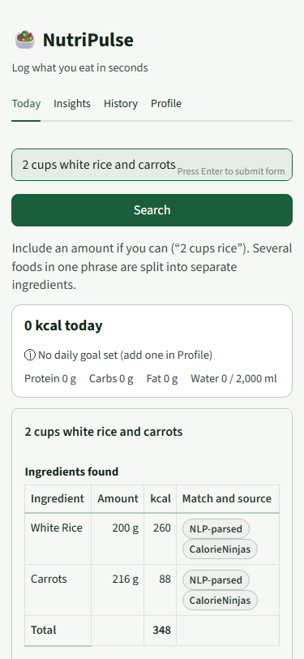
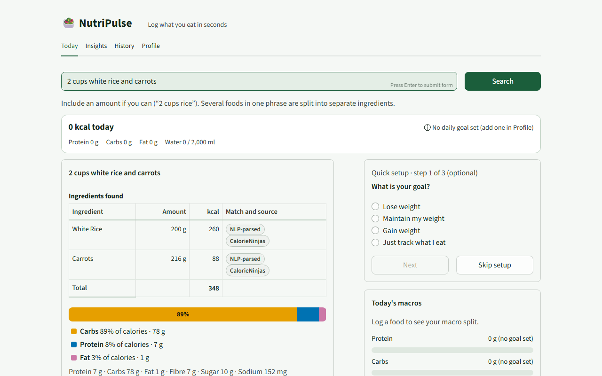

<div align="center">

# 🥗 NutriPulse

### A phone-friendly nutrition and fitness tracker

[](https://github.com/vanshikagurbani/nutripulse/actions/workflows/ci.yml)
[](https://nutripulse.streamlit.app/)
[](https://python.org)
[](https://streamlit.io)
[](https://fdc.nal.usda.gov/)
[](https://calorieninjas.com/api)

</div>

---

## ✨ What is NutriPulse?

NutriPulse is a nutrition tracker built with **Streamlit** and two nutrition APIs. Type a natural phrase like *"2 cups white rice with carrots"* and it is split into ingredients, each with its own amount, calories and macros, which you can adjust before logging. It also tracks water and exercise, keeps your history, and shows insights against your own goals.

> Built as a personal project, NutriPulse demonstrates API integration, a tested matching algorithm, a measured evaluation, and a UX redesign checked with before/after measurements.



| Today (phone) | Today (desktop) |
|---|---|
|  |  |

Before/after screenshots of every tab at 375 px and 1280 px are in [`docs/ux/before`](docs/ux/before) and [`docs/ux/after`](docs/ux/after).

---

## 🚀 Features

| Area | What you get |
|---|---|
| **Search first** | The search box is the first thing on Today. Press Enter to search; on desktop it is focused on load. |
| **Ingredient breakdown** | A multi-food phrase becomes a table: ingredient, amount, kcal, source badge and match badge. Edit amounts, remove items. |
| **Amounts you can trust** | Weights you type are used as stated; cups and spoons use the food's own USDA serving size. If you give no weight ("1 banana"), the app asks, offers USDA's serving sizes, and won't log until you confirm. |
| **Fix the match** | "Not right? Pick another match" lists the five best USDA candidates; low-confidence matches open it for you. Your choice is saved. |
| **One-tap foods** | Recent foods and ★ favorites appear as chips. The meal defaults to the time of day. |
| **Persistent** | Log, goals, water, exercise and history are saved automatically under a private link (see limitations); refresh keeps them. Undo after add or remove. |
| **Setup without hidden defaults** | An optional 3-step setup (goal, body stats, done). Skip it and you simply have no calorie goal. No example profile is silently used. |
| **Insights** | Nutrition grade, suggestions, radar vs your targets, calories by meal, two-food comparison, for any logged day. |
| **History** | Daily totals are saved automatically; trend chart; CSV export. "Load a sample week" shows everything populated. |
| **Accessible** | Colour-blind-safe macro palette with text labels, readable text sizes, visible keyboard focus, semantic tables. |
| **Match feedback** | 👍/👎 on each result and a hidden admin view (`?admin=1`) for the match-confirmed rate (local SQLite; not a benchmark result). |

---

## 📊 Results

<!-- results:start -->
Benchmark results are written to [`benchmark/results.md`](benchmark/results.md) and copied here by `python -m benchmark.sync_readme`.
The accuracy benchmark needs human-labelled ground truth, which has not been produced yet, so no accuracy figure is reported.
<!-- results:end -->

UX measurements (before vs after redesign, same scripts, same machine) are in [`docs/ux/metrics-comparison.md`](docs/ux/metrics-comparison.md); the claims I consider defensible are listed with their sources in [`docs/ux/CLAIMS.md`](docs/ux/CLAIMS.md).

---

## 🧭 UX decisions

- **Search is the primary action, so it is first.** Calorie goal, macros and water used to sit above it (search box at y = 1,179 px on a phone). Goals now live in Profile and a one-line summary sits under the search.
- **Show what the API understood.** The old result merged "rice and carrots" into one 416 g row. Splitting it makes mistakes visible and fixable.
- **Make uncertainty explicit and actionable.** Match badges are hints from the scorer, not probabilities, and each ingredient has a way out ("Pick another match").
- **No invented personal data.** The old app computed a calorie need from an example 25-year-old profile. Now nothing is assumed; skipping setup means no goal.
- **Save automatically, offer undo.** Manual "Save" buttons and silent data loss on refresh are gone.
- **Rerun less.** Water, exercise, chips, amount edits and match changes rerun only the Today fragment; only changes other tabs must show rerun the whole app.
- **Colour is never the only signal.** Okabe-Ito palette plus text labels and values next to every bar.
- **Theme through config, not CSS hooks.** Colours come from `.streamlit/config.toml`; the stylesheet uses only generic selectors and its own classes.

Full list of changes and the problem each one fixes: [`docs/ux/CHANGELOG.md`](docs/ux/CHANGELOG.md). Original problems: [`docs/ux/audit.md`](docs/ux/audit.md).

---

## 🔬 How the food search works

```
"2 cups white rice and carrots"
        │
        ▼
 CalorieNinjas NLP ──► one record per ingredient, amounts parsed
 (primary)
        │ no answer
        ▼
 USDA FoodData Central ──► 3 data-type searches in parallel (Foundation, FNDDS, SR Legacy)
 (fallback)                 retried on USDA's intermittent HTTP 400s
                            ranked by a rule-based scorer; top 5 kept for "Pick another match"
                            multi-food phrases one match cannot explain are split into ingredients
```

The USDA scorer combines weighted terms: name starts with the query, query words in the first tokens, word hits, cooked-over-raw for prepared foods, a penalty when the first word is not in the query, a wrong-category penalty ("Bread, oatmeal" for "oatmeal"), a penalty for implausible calories, and a brevity term. Its terms and weights live in [`nutripulse/matching.py`](nutripulse/matching.py).

---

## 🧪 Methodology and limitations

- **Benchmark design.** 139 queries split about 50/50 into dev and test ([`benchmark/queries.csv`](benchmark/queries.csv)). Scorer weights may be tuned on dev only; every reported number comes from the test split. The scripts refuse to report on partially labelled data.
- **Labeler bias.** Ground truth is a person's judgement of which USDA entries are acceptable. One labeler is a single point of view; a second labeler on a subset gives Cohen's kappa. Candidates are shown in shuffled order, but a labeler can still prefer particular entries.
- **Candidate pool.** Only candidates shown on the labeling sheet are labelled. A system that picks an unlabelled candidate is counted wrong, and these cases are reported.
- **API data drift.** USDA and CalorieNinjas data change over time. Responses are cached in [`benchmark/cache`](benchmark/cache) so runs are reproducible, but results describe the data on the date they were collected.
- **Scope.** English queries and common US foods only. Results do not transfer to other cuisines or languages.
- **CalorieNinjas has no food ids**, so it cannot be scored on exact match. It is compared on a separate, weaker "calories within 20%" criterion.
- **Operational metrics** come from a synthetic replay session, not real traffic, on one machine and network.
- **Persistence.** Data is stored on the app server in SQLite, keyed by a random id in the URL. Anyone with the link can open that data; there are no accounts. Streamlit Community Cloud can wipe local storage on restart. Download your history if it matters.
- **Not medical advice.** Calorie targets use the Mifflin-St Jeor equation and coarse adjustments. Estimates only.

---

## 🛠️ Tech stack

```
UI           Streamlit 1.48+     fragments, forms, theme via config.toml
Charts       Plotly              radar, donut, trend, comparison
Data         SQLite              per-user state and match feedback (stdlib)
APIs         CalorieNinjas       natural-language parsing (primary)
             USDA FoodData       fallback with a rule-based relevance scorer
Quality      pytest, ruff        run in GitHub Actions on every push and PR
UX tooling   Playwright, axe-core, Lighthouse   before/after measurements in tools/ux
```

---

## ⚡ Quick start

```bash
git clone https://github.com/VanshikaGurbani/NutriPulse.git
cd NutriPulse
pip install -r requirements.txt
```

Create a `.env` file (see `.env.example`):

```env
USDA_API_KEY=your_usda_key_here
CALORIENINJAS_KEY=your_calorieninjas_key_here
```

| API | Free tier | Get a key |
|---|---|---|
| USDA FoodData Central | 3,500 calls/day | [api.data.gov](https://api.data.gov/signup/) |
| CalorieNinjas | 10,000 calls/month | [calorieninjas.com/api](https://calorieninjas.com/api) |

```bash
streamlit run nutrition_tracker.py
```

Tests and lint (no network needed):

```bash
pip install pytest ruff
ruff check .
pytest
```

### Running the benchmark

```bash
python -m benchmark.make_labeling_sheet      # 10 shuffled USDA candidates per query (cached; stops at 500 live calls)
# label every row y or n in benchmark/labeling_sheet.csv, then:
python -m benchmark.apply_labels benchmark/labeling_sheet.csv
python -m benchmark.run_benchmark tune       # dev split only
python -m benchmark.run_benchmark report     # test split only -> benchmark/results.md, results.csv, charts/
python -m benchmark.run_meals                # needs reference values in benchmark/meals.csv
python -m benchmark.ops_metrics              # latency, fallback rate, cache hit rate
python -m benchmark.sync_readme              # copy results.md into this README
```

---

## 📁 Project structure

```
NutriPulse/
├── nutrition_tracker.py        # thin Streamlit entry point
├── nutripulse/
│   ├── apis.py                 # CalorieNinjas + USDA clients: timeouts, retries, typed errors, call budget
│   ├── matching.py             # query parsing, scorer (terms + weights), candidate ranking
│   ├── lookup.py               # free text -> ingredient list, alternatives, match swap
│   ├── nutrition.py            # Mifflin-St Jeor TDEE, grade, tips, unit and goal helpers
│   ├── store.py                # SQLite persistence and automatic daily snapshots
│   ├── cache.py                # disk JSON cache + API-call counters
│   ├── feedback.py             # thumbs and match-correction log
│   └── ui/                     # today, insights, history, profile, onboarding, style
├── benchmark/                  # queries, labeling tools, runner, results, API cache
├── tests/                      # unit, store, lookup and headless UI tests
├── tools/ux/                   # screenshots, click/latency/axe/Lighthouse measurement, e2e smoke test
├── docs/ux/                    # audit, before/after screenshots, metrics, changelog, claims, usability test kit
└── .streamlit/config.toml      # theme
```

---

## 📜 License

MIT: free to use, modify, and distribute.

---

<div align="center">

Built with 💚 using [Streamlit](https://streamlit.io) · Data from [USDA FoodData Central](https://fdc.nal.usda.gov/) & [CalorieNinjas](https://calorieninjas.com)

</div>
